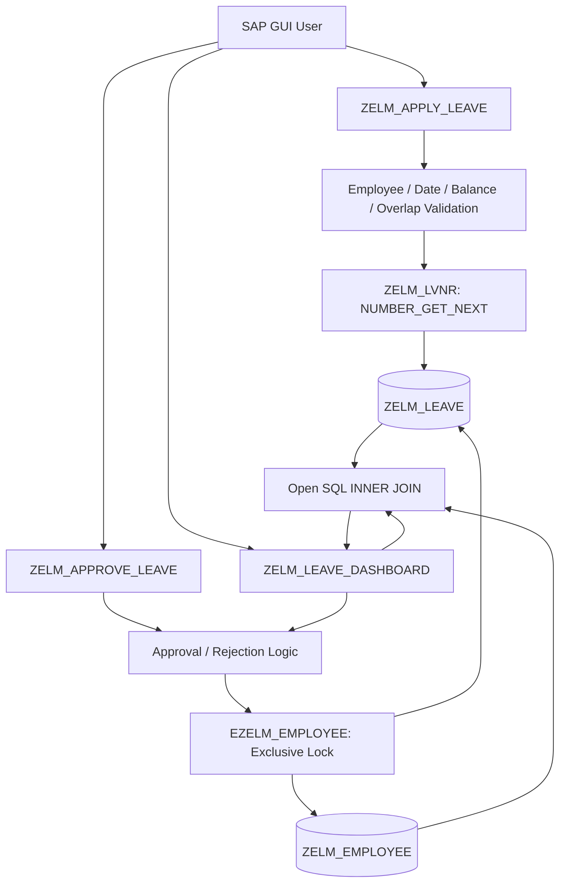
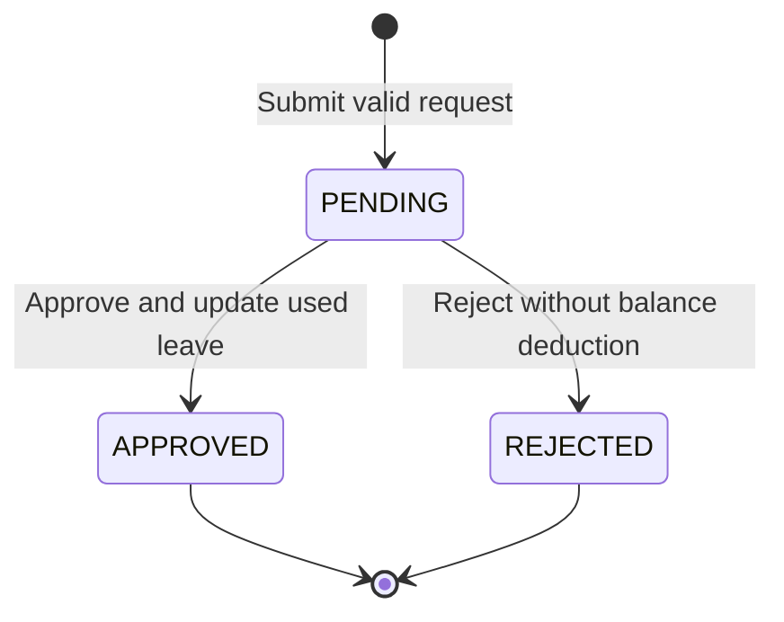
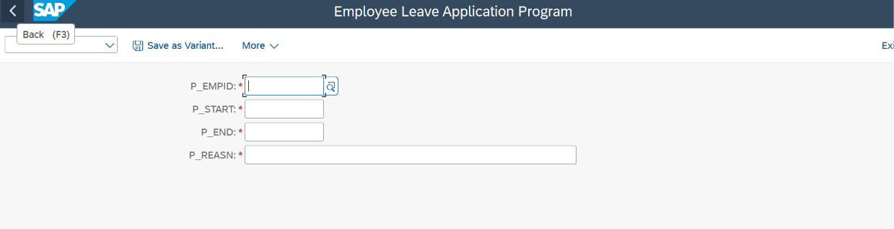
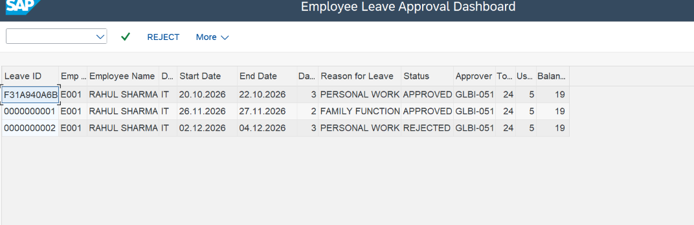
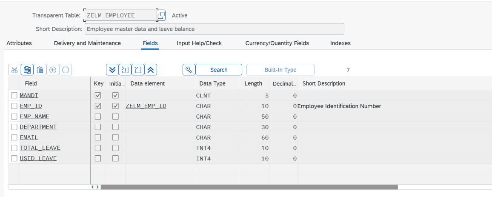
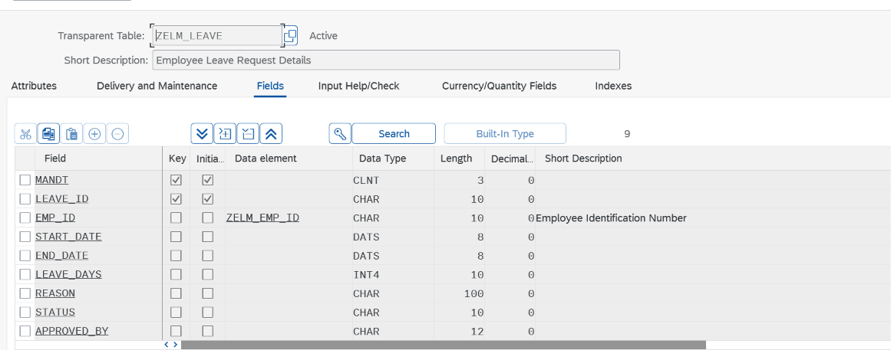
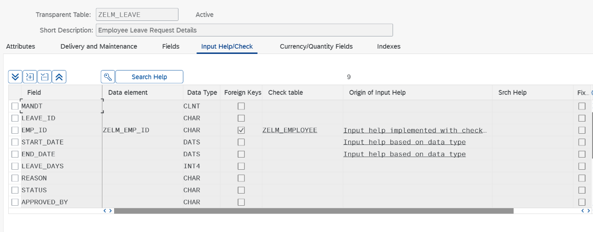
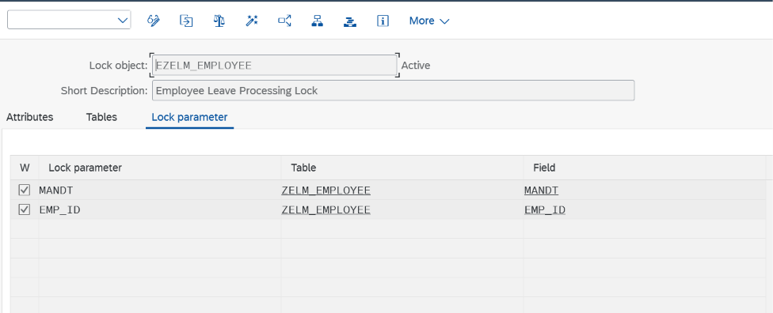
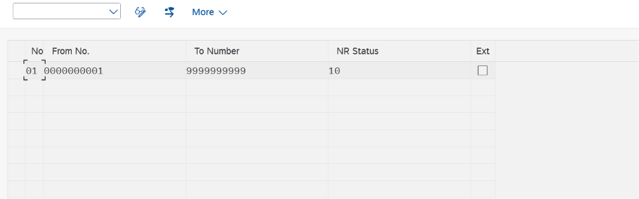

<div align="center">

# SAP ABAP Employee Leave Management System

### An Interactive Leave Application & Approval Solution Built with SAP ABAP


**Leave applications · Approval workflows · Balance validation · Interactive ALV dashboard**

</div>

---

## Overview

The **Employee Leave Management System** is a custom SAP ABAP application that manages employee leave requests from submission through approval or rejection. It combines ABAP Dictionary tables, Open SQL, SAP number ranges, enqueue/dequeue locking, and an event-driven **`CL_SALV_TABLE` dashboard**.

This is a learning and portfolio project developed and tested in an SAP ABAP environment. It is **not yet production-ready**; authorization controls and further concurrency safeguards are planned improvements.

## Features

| Module | Capabilities |
| --- | --- |
| **Leave application** | Validate employee, dates, leave balance, and overlapping requests; create `PENDING` requests |
| **Leave approval** | Approve or reject pending requests; prevent repeat processing; record processing SAP user |
| **Leave balance** | Increase `USED_LEAVE` only for approved requests; calculate remaining balance |
| **Interactive ALV** | Filter by employee, view pending/all requests, approve or reject a selected row |
| **Data consistency** | Exclusive employee lock during approval; commit or roll back database changes |
| **Unique IDs** | Generate leave request numbers using `NUMBER_GET_NEXT` and `ZELM_LVNR` |

## Tech Stack

`SAP ABAP` · `ABAP Dictionary (SE11)` · `Open SQL` · `OO ABAP` · `CL_SALV_TABLE` · `SNRO` · `Enqueue/Dequeue` · `PF-STATUS` · `SAP GUI`

## Architecture



### Leave request lifecycle



## SAP Development Objects

| Type | Object | Purpose |
| --- | --- | --- |
| Package | `ZEMP_LEAVE_MGMT` | Project development package |
| Transparent table | `ZELM_EMPLOYEE` | Employee details and leave balance |
| Transparent table | `ZELM_LEAVE` | Leave requests and status |
| Data element | `ZELM_EMP_ID` | Employee identifier |
| Lock object | `EZELM_EMPLOYEE` | Exclusive employee-level approval lock |
| Number range | `ZELM_LVNR` | Internally assigned 10-digit leave IDs |
| Executable report | `ZELM_APPLY_LEAVE` | Create leave applications |
| Executable report | `ZELM_APPROVE_LEAVE` | Approve or reject by leave ID |
| Executable report | `ZELM_LEAVE_DASHBOARD` | Interactive ALV processing |
| GUI status | `ZLEAVE_STATUS` | Custom `ZAPPROVE` / `ZREJECT` functions |

## Database Design

### `ZELM_EMPLOYEE`

| Field | Type | Description |
| --- | --- | --- |
| `MANDT` | `CLNT(3)` | Client; primary key |
| `EMP_ID` | `CHAR(10)` | Employee ID; primary key |
| `EMP_NAME` | `CHAR(50)` | Employee name |
| `DEPARTMENT` | `CHAR(30)` | Department |
| `EMAIL` | `CHAR(60)` | Email |
| `TOTAL_LEAVE` | `INT4` | Allocated leave days |
| `USED_LEAVE` | `INT4` | Approved leave days used |

### `ZELM_LEAVE`

| Field | Type | Description |
| --- | --- | --- |
| `MANDT` | `CLNT(3)` | Client; primary key |
| `LEAVE_ID` | `CHAR(10)` | Leave ID; primary key |
| `EMP_ID` | `CHAR(10)` | Foreign key to employee |
| `START_DATE` | `DATS` | Leave start |
| `END_DATE` | `DATS` | Leave end |
| `LEAVE_DAYS` | `INT4` | Inclusive calendar days |
| `REASON` | `CHAR(100)` | Leave reason |
| `STATUS` | `CHAR(10)` | `PENDING`, `APPROVED`, or `REJECTED` |
| `APPROVED_BY` | `CHAR(12)` | SAP user who processed the request |

**Relationship:** One employee can have many leave requests. `ZELM_LEAVE-EMP_ID` uses `ZELM_EMPLOYEE` as its check table.

**Balance formula:** `Available Leave = TOTAL_LEAVE - USED_LEAVE`

**Duration formula:** `LEAVE_DAYS = END_DATE - START_DATE + 1` (calendar days, including weekends and holidays).

## Application Workflow

1. Run `ZELM_APPLY_LEAVE` and enter employee ID, start date, end date, and reason.
2. The report checks employee existence, date validity, remaining balance, and overlap with pending/approved requests.
3. `NUMBER_GET_NEXT` allocates an ID from number range interval `01`; the request is inserted with status `PENDING`.
4. Open `ZELM_LEAVE_DASHBOARD` to view pending requests or all requests.
5. Select **one** pending row and use the custom **Approve** or **Reject** toolbar action.
6. The approval logic locks the employee, re-reads the request, checks the current balance, updates records, commits or rolls back, releases the lock, and refreshes the ALV.

## Number Range and Lock Configuration

| Setting | Value |
| --- | --- |
| Number range object | `ZELM_LVNR` |
| Interval | `01` |
| From / To | `0000000001` / `9999999999` |
| Assignment | Internal (`Ext` unchecked) |
| Number length domain | `NUMC10` |
| Lock object | `EZELM_EMPLOYEE` |
| Lock table | `ZELM_EMPLOYEE` |
| Lock mode | Exclusive, not cumulative |

The generated lock function modules are `ENQUEUE_EZELM_EMPLOYEE` and `DEQUEUE_EZELM_EMPLOYEE`.

## Testing

The following scenarios were manually verified in SAP GUI:

| Scenario | Result |
| --- | --- |
| Submit a valid leave request | Passed |
| Approve a pending request | Passed |
| Reject a pending request | Passed |
| Reject overlapping pending/approved dates | Passed |
| Reject a request exceeding available leave | Passed |
| Reject start date after end date | Passed |
| Reject past start date | Passed |
| Prevent duplicate approval | Passed |
| Verify approved days match `USED_LEAVE` | Passed |
| Display and refresh interactive ALV | Passed |

**Example verification:** `TOTAL_LEAVE = 24`, `USED_LEAVE = 5`, and **available leave = 19**. Two approved requests used 3 and 2 days; a rejected 3-day request did not reduce the balance.

## Screenshots

> Add your own SAP GUI screenshots to the `screenshots/` folder. The image links below will render once those files are uploaded.

| Leave Application | Interactive ALV Dashboard |
| --- | --- |
|  |  |

<details>
<summary><strong>View SAP Dictionary and configuration screenshots</strong></summary>

**Employee master table**



**Leave request table**



**Foreign key configuration**



**Exclusive lock object**



**Number range interval**



</details>

## Suggested Repository Structure

```text
SAP-ABAP-Employee-Leave-Management/
├── README.md
├── src/
│   ├── ZELM_APPLY_LEAVE.abap
│   ├── ZELM_APPROVE_LEAVE.abap
│   └── ZELM_LEAVE_DASHBOARD.abap
├── docs/
│   ├── architecture.md
│   ├── database-design.md
│   ├── configuration.md
│   └── test-cases.md
└── screenshots/
    ├── employee_table.png
    ├── leave_table.png
    ├── foreign_key.png
    ├── lock_object.png
    ├── number_range.png
    ├── leave_application.png
    └── leave_dashboard.png
```

## Setup Notes

This repository documents custom objects developed in an existing SAP ABAP system; it is **not a standalone application** that can run without SAP.

1. Create package `ZEMP_LEAVE_MGMT` and the required DDIC objects in `SE11`.
2. Define the employee-to-leave foreign key and activate the tables.
3. Create and activate `EZELM_EMPLOYEE` with an exclusive employee lock.
4. Configure `ZELM_LVNR` in `SNRO` with internal interval `01`.
5. Create the three executable ABAP reports in `SE38` or ADT.
6. Create GUI status `ZLEAVE_STATUS` with `ZAPPROVE` and `ZREJECT` function codes.
7. Add sample employee records and execute the reports to verify the workflow.

> **Note:** ABAP source files alone do not recreate DDIC definitions, number range customizing, or the GUI status. Document/export those objects separately before treating this repository as reproducible.

## Future Improvements

- Role-based authorization checks for approval and rejection.
- Employee locking during submission to prevent concurrent overlapping requests.
- Approval-time overlap checks and pending-leave reservation policy.
- Holiday calendars, working-day calculations, and leave categories.
- Audit timestamps and clearer approval/rejection history.
- ABAP Unit tests and additional concurrency testing.
- SAP Fiori user interface.

---

<div align="center">

**Built as a hands-on SAP ABAP development project.**

</div>
