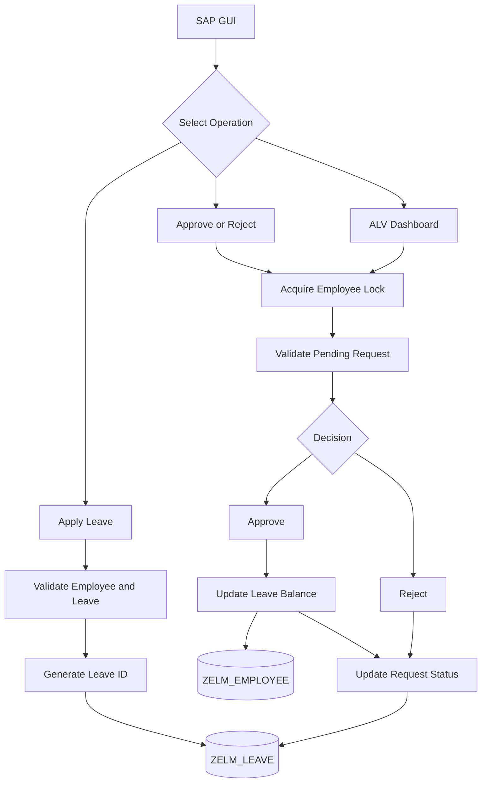

# System Architecture

## Project Overview

The Employee Leave Management System is developed
using SAP ABAP and SAP GUI.

It manages employee leave applications, approvals,
rejections, and leave balances.

## Architecture Diagram

## ABAP Programs

| Program | Description |
|---|---|
| ZELM_APPLY_LEAVE | Creates leave applications |
| ZELM_APPROVE_LEAVE | Approves or rejects leave |
| ZELM_LEAVE_DASHBOARD | Interactive ALV dashboard |

## SAP Technologies

- ABAP Dictionary
- Open SQL
- Object-Oriented ABAP
- CL_SALV_TABLE
- SAP Lock Objects
- Number Range Objects
- COMMIT WORK and ROLLBACK WORK

## Leave Application Workflow

1. Employee enters leave details.
2. System validates employee existence.
3. System validates dates and leave balance.
4. System checks overlapping requests.
5. System generates a unique leave ID.
6. Request is saved with PENDING status.

## Approval Workflow

1. User selects a pending leave request.
2. System acquires an employee-level lock.
3. System revalidates the request.
4. System checks available leave balance.
5. Approval updates USED_LEAVE.
6. Rejection updates only request status.
7. Database transaction is committed.
8. Employee lock is released.
9. ALV dashboard is refreshed.