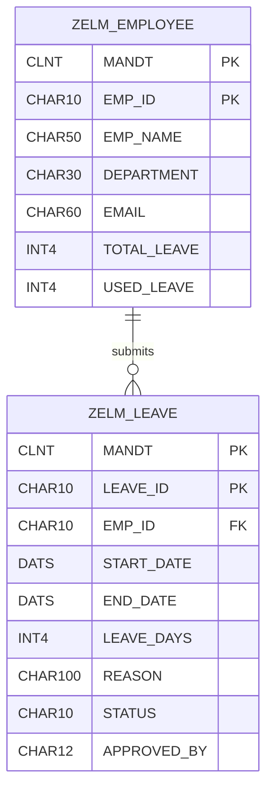

# Database Design — Employee Leave Management System

## 1. Overview

The Employee Leave Management System uses two custom SAP ABAP Dictionary transparent tables:

- `ZELM_EMPLOYEE` — Stores employee master data and leave balances.
- `ZELM_LEAVE` — Stores leave applications and their approval status.

Both tables are client-dependent and use `MANDT` as part of their primary keys.

The relationship between the tables is one-to-many: one employee can submit multiple leave requests.

## 2. Entity Relationship Diagram



The foreign key `ZELM_LEAVE-EMP_ID` references the employee master table `ZELM_EMPLOYEE`.

The client field `MANDT` is also relevant to the client-dependent relationship.

## 3. Employee Master Table — ZELM_EMPLOYEE

**Description:** Employee master data and leave balance.

**Primary Key:** `MANDT + EMP_ID`

| Field | Data Type | Key | Description |
|---|---|---|---|
| MANDT | CLNT(3) | Yes | SAP client |
| EMP_ID | CHAR(10) | Yes | Employee ID |
| EMP_NAME | CHAR(50) | No | Employee name |
| DEPARTMENT | CHAR(30) | No | Employee department |
| EMAIL | CHAR(60) | No | Employee email |
| TOTAL_LEAVE | INT4 | No | Total allocated leave |
| USED_LEAVE | INT4 | No | Approved leave days used |

### Leave Balance Formula

```text
AVAILABLE_LEAVE = TOTAL_LEAVE - USED_LEAVE
```

Example:

```text
TOTAL_LEAVE     = 24
USED_LEAVE      = 5
AVAILABLE_LEAVE = 19
```

The available balance is calculated dynamically rather than stored as a separate database field.

## 4. Leave Request Table — ZELM_LEAVE

**Description:** Employee leave request details.

**Primary Key:** `MANDT + LEAVE_ID`

| Field | Data Type | Key | Description |
|---|---|---|---|
| MANDT | CLNT(3) | Yes | SAP client |
| LEAVE_ID | CHAR(10) | Yes | Unique leave request ID |
| EMP_ID | CHAR(10) | No | Employee reference |
| START_DATE | DATS | No | Leave start date |
| END_DATE | DATS | No | Leave end date |
| LEAVE_DAYS | INT4 | No | Requested leave days |
| REASON | CHAR(100) | No | Reason for leave |
| STATUS | CHAR(10) | No | Request status |
| APPROVED_BY | CHAR(12) | No | SAP user who processed request |

### Leave Status Values

| Status | Meaning |
|---|---|
| PENDING | Awaiting approval or rejection |
| APPROVED | Request approved |
| REJECTED | Request rejected |

### Leave Duration Formula

```text
LEAVE_DAYS = END_DATE - START_DATE + 1
```

The current implementation calculates inclusive calendar days, including weekends and holidays.

## 5. Foreign Key Relationship

The foreign key is configured in SAP transaction `SE11`.

| Property | Value |
|---|---|
| Foreign Key Table | ZELM_LEAVE |
| Foreign Key Field | EMP_ID |
| Check Table | ZELM_EMPLOYEE |
| Data Element | ZELM_EMP_ID |

This relationship supports employee ID validation and SAP Dictionary input checks.

## 6. Database Operations

### Leave Application

The `ZELM_APPLY_LEAVE` report:

1. Reads the employee master record.
2. Checks the available balance.
3. Checks overlapping requests.
4. Generates a leave ID using SAP number ranges.
5. Inserts the request into `ZELM_LEAVE`.

### Leave Approval

The `ZELM_APPROVE_LEAVE` report:

1. Reads the pending request.
2. Acquires an employee lock.
3. Reads the latest employee balance.
4. Updates `ZELM_EMPLOYEE-USED_LEAVE`.
5. Updates the request status to `APPROVED`.
6. Commits the transaction.

### Leave Rejection

Rejection changes the request status to `REJECTED` without updating `USED_LEAVE`.

### Dashboard

The `ZELM_LEAVE_DASHBOARD` report uses an Open SQL `INNER JOIN` to retrieve employee and leave request information.

## 7. Data Integrity

The application uses:

- Primary keys to uniquely identify records.
- An ABAP Dictionary foreign key for employee references.
- Exclusive employee locks during approval processing.
- Request status checks to prevent duplicate processing.
- `COMMIT WORK` and `ROLLBACK WORK` for transaction handling.
- Number range-based leave ID generation.

## 8. Design Limitations

- The current model does not distinguish sick, casual, or earned leave.
- There is no separate approval history table.
- Leave duration is based on calendar days.
- Employee leave balances are stored as aggregated values.
- Additional concurrency safeguards are recommended for leave submission.

## 9. SAP Transactions Used

| Transaction | Purpose |
|---|---|
| SE11 | Define and inspect DDIC tables |
| SE16N | Verify stored database records |
| SE38 | Execute ABAP reports |
| SNRO | Configure leave request number ranges |
